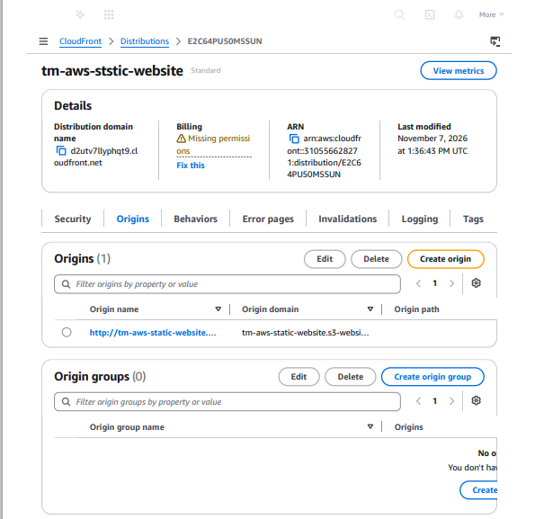

#AWS S3 Static Website + Cloudfront

##Project Overview
Hosted a static Business Website using Amazon S3 and delivered globally using Amazon Cloudfront

##Architecture
User
 |
Amazon S3 Bucket
 |_________Website Objects
           Bucket Policy
 |
 Amazon Cloudfront

##AWS Service Used
 -AWS IAM
 -Amazon S3
 Amazon Cloudfront

 ##Links:
 Website link:

http://tm-aws-static-website.s3-website.eu-north-1.amazonaws.com

Distribution and Origin Access Contol:

##Skills  Demostrated
 -AWS S3
 -Amazon Cloudfront
 -IAM permission
 -Cloud Architecture basics
 -Static Website deployment
 -CDN concept

##What I learned
Through this project, I learned How Cloud Service work together to deliver a secure and scalable website.
The project strengthened my understading of AWS Storage,networking,security and deliver concept.
